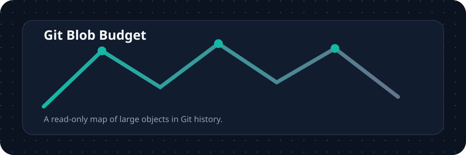

<div align="center">


[](LICENSE)




</div>

## :compass: Overview
A read-only CLI that ranks the largest file blobs reachable from Git refs, helping teams spot accidental binaries and repository history growth before clones become expensive.

## :sparkles: Features
- :mag: Scans reachable Git objects without checking out files
- :package: Ranks historical blobs by size and path
- :control_knobs: Supports a minimum-size threshold and JSON output
- :shield: Never rewrites history or deletes objects

## :clapper: Demo
```bash
python main.py --repo . --min-mb 0.5 --limit 10
```
The command prints the largest matching blobs in the selected repository.

## :rocket: Quick Start
```bash
python -m pip install -r requirements.txt
python main.py --repo . --min-mb 1
```
Git must be installed and available on PATH.

## :toolbox: Tech Stack
- Python 3.10+ standard library
- unittest
- Local, read-only Git inspection

## :file_folder: Folder Structure
```text
git-blob-budget/
├── main.py
├── requirements.txt
├── tests/test_core.py
├── examples/README.md
└── assets/illustration.svg
```

## :world_map: Roadmap
- [x] Read-only object inventory
- [x] Human-readable and JSON reports
- [ ] Optional CSV export
- [ ] GitHub Actions summary output

## :handshake: Contributing
Issues and pull requests are welcome. Keep changes focused and add tests for new behavior.

## :page_facing_up: License
MIT - see [LICENSE](LICENSE).

<div align="center"></div>
